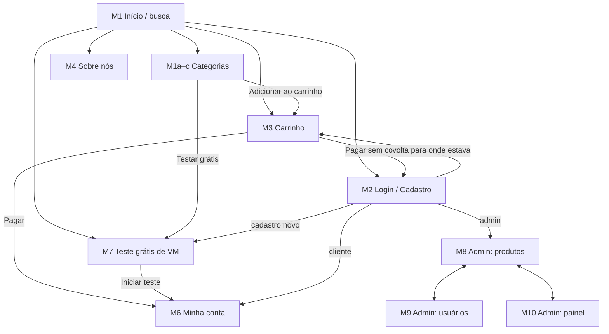

# Cache & Carry — Servidores na nuvem e VPN

**Grupo:** 3

| Nome | Nº USP |
|------|--------|
| _Pedro Henrique de Holanda_ | _14602612_ |
| _Luiz Henrique Nogueira dos Santos_ | _14755054_ |


Cache & Carry é uma loja online, feita para pessoas, que vende máquinas virtuais (VMs) e planos de VPN. Os clientes escolhem planos mensais com preços fixos em reais, pagam com cartão de crédito e acompanham seus serviços na própria conta. Todo cliente novo pode testar uma VM Standard de graça por 14 dias.

> **Etapa atual:** Versão Final — servidor em Node.js (Express) com API REST, banco de dados NoSQL (MongoDB) e front-end como Single-Page Application em JavaScript puro, com um roteador próprio.

---

## 1. Requisitos

**Requisitos do enunciado**

1. Dois tipos de usuário: clientes e administradores.
2. O sistema já vem com o administrador `admin`, senha `admin`.
3. Administrador tem: nome, id, telefone e e-mail.
4. Cliente tem: nome, id, endereço, telefone e e-mail.
5. Produto tem: nome, id, foto, descrição, preço, quantidade em estoque e quantidade vendida.
6. Venda: o cliente escolhe produtos e quantidades, coloca no carrinho e paga com cartão de crédito (qualquer número é aceito). Ao pagar, a quantidade comprada sai do estoque e soma na quantidade vendida. O carrinho só é esvaziado no pagamento ou pelo próprio cliente.
7. Administradores podem criar, ver, editar e excluir produtos (incluindo o estoque).
8. Administradores podem cadastrar e gerenciar administradores e clientes.
9. Funcionalidade específica da loja (ver requisito 11).
10. O sistema deve ser acessível, fácil de usar e rápido.

**Requisitos adicionados pelo grupo**

11. **Teste grátis de VM (nossa funcionalidade).** Cada conta pode iniciar um teste gratuito de 14 dias de uma VM Standard (2 vCPU, 4 GB RAM, 80 GB SSD), sem cartão de crédito. O cliente escolhe o sistema operacional, o data center, o nome do servidor e, opcionalmente, uma chave SSH. Ao fim dos 14 dias a VM é pausada e os arquivos ficam guardados por mais 7 dias; o cliente pode fazer upgrade para o plano pago a qualquer momento. Cada teste ativo consome uma unidade do estoque da VM Standard.
12. Os clientes são pessoas: nome, e-mail, telefone e endereço de cobrança.
13. Os produtos ficam em categorias: Máquinas virtuais, VPN e Add-ons (IP dedicado, backups, armazenamento extra).
14. Não é possível comprar mais do que existe em estoque (vagas disponíveis por data center). Produtos sem estoque aparecem como "Sold out".
15. Busca de produtos por nome.
16. Página "Sobre nós" com a história da loja, a equipe e o contato.
17. **WebMCP.** A loja expõe ferramentas (tools) para agentes de IA rodando no navegador, para que um assistente possa buscar planos, ver detalhes e montar o carrinho. O pagamento é sempre confirmado pela pessoa: não existe ferramenta de pagar.
18. Opções de compra: VMs levam o data center e o sistema operacional escolhidos; planos de VPN levam o país de saída padrão.
19. Um visitante pode montar o carrinho sem conta; ao entrar ou se cadastrar, os itens passam para o carrinho do cliente.

**Requisitos da Versão Final**

20. Servidor em Node.js e banco de dados NoSQL (MongoDB).
21. Serviços web RESTful: todas as regras e todos os dados ficam no servidor; o navegador só mostra e envia pedidos.
22. Aplicação de página única (SPA) com URLs limpas (`/vms`, `/cart`, `/admin/products`), botão Voltar funcionando e `index.html` distribuível.
23. Os papéis (cliente, administrador) são decididos **só pelo servidor**, por sessão. O navegador não consegue virar administrador.
24. Dois clientes não podem comprar a mesma última unidade: o estoque nunca fica negativo, mesmo com pedidos simultâneos.
25. **Capacidade real das VMs.** O estoque de VMs não é um número digitado: vem dos servidores físicos cadastrados (CPU, RAM, disco, GPU por data center), com alocação do primeiro encaixe. O administrador adiciona servidores no painel.
26. Cartão vencido é recusado no pagamento (qualquer outro número é aceito, como pede o enunciado).
27. Assinaturas pré-pagas (1, 3 ou 12 meses) que expiram sozinhas e devolvem a capacidade; cancelamento com reembolso proporcional.

---


## 2. Descrição do Projeto

### Funcionalidades implementadas

- **Visitante:** ver os planos (início e páginas de categoria), ordenar, buscar por nome, adicionar ao carrinho, ler a página Sobre nós, se cadastrar e entrar.
- **Cliente:** tudo do visitante, mais pagamento com cartão, histórico de pedidos, assinaturas (com cancelamento), edição dos próprios dados e da senha, e o teste grátis de VM (um por conta).
- **Administrador:** criar, ver, editar e excluir produtos (incluindo estoque, quantidade vendida e foto); cadastrar, editar e excluir clientes e administradores; painel com vendas, assinaturas e a infraestrutura (servidores físicos e uso de CPU, RAM, disco e GPU).
- **Agentes de IA (WebMCP):** buscar e consultar produtos, adicionar e alterar itens do carrinho e abrir a página de pagamento.

Regras de venda, como pede o enunciado: não dá para colocar no carrinho mais do que existe em estoque; ao pagar, a quantidade comprada sai do estoque e soma na quantidade vendida; o carrinho só é esvaziado no pagamento ou pelo próprio cliente. O pagamento é verificado de novo **no servidor** no momento de pagar: se o estoque acabou depois de o item entrar no carrinho, nada é cobrado.

### Arquitetura

```
 Navegador (SPA)                      Servidor Node.js (Express)                MongoDB
 ───────────────                      ──────────────────────────                ───────
 index.html + static/js/*   ──fetch──▶  /api/...  rotas REST (server/routes)
 roteador (History API)     ◀──JSON───  serviços com as regras (server/services)  ──▶  coleções
 cookie de sessão HttpOnly              sessões, papéis, limite de tentativas
```

- **Banco:** coleções `products`, `users`, `sessions`, `carts`, `orders`, `trials`, `subscriptions`, `servers` e `meta`.
- **Sessões:** cookie `cc_sid` (HttpOnly, SameSite=Lax) com um identificador aleatório de 32 bytes; a sessão fica na coleção `sessions` e é trocada a cada login. O papel vem do banco, nunca do navegador.
- **Senhas:** `scrypt` com sal aleatório (campos `salt` e `passwordHash`); comparação em tempo constante. Depois de 8 tentativas erradas em 1 minuto o login responde 429.
- **Concorrência:** não dependemos de transações do MongoDB. Toda operação que muda estado passa por um mutex do processo (`server/lock.js`), usa atualizações condicionais atômicas (por exemplo `stock: {$gte: qtd}`) e desfaz manualmente se algum passo do pagamento falhar. **Limite conhecido:** funciona para um único processo Node; para vários processos seria preciso usar transações do MongoDB (replica set).
- **Capacidade das VMs:** `server/capacity.js` lê as especificações do produto, soma o que as assinaturas e os testes ativos ocupam em cada servidor físico e calcula quantas VMs ainda cabem em cada data center.
- **Expiração:** assinaturas e testes vencidos são encerrados (e a capacidade devolvida) ao consultar os dados e por um temporizador de 60 s.

### Telas (rotas da SPA)

Uma só página (`index.html`) com cabeçalho e rodapé fixos; o roteador ([`static/js/router.js`](static/js/router.js)) troca o conteúdo de `<main>` com fragmentos de [`static/views/`](static/views) e o script de cada tela. As URLs são limpas e o servidor devolve `index.html` para qualquer endereço que não seja `/api`, então recarregar ou abrir um link direto funciona. A cada troca de tela o foco vai para o título (acessibilidade) e os eventos da tela anterior são desligados.

| ID | Tela | Rota | Quem acessa |
|----|------|------|-------------|
| M1 | Página inicial, planos e resultados da busca | `/` e `/?q=termo` | todos |
| M1a | Categoria: máquinas virtuais | `/vms` | todos |
| M1b | Categoria: VPN | `/vpn` | todos |
| M1c | Categoria: add-ons | `/addons` | todos |
| M2 | Login e cadastro | `/login` | todos |
| M3 | Carrinho e pagamento | `/cart` | todos (pagar: cliente) |
| M4 | Sobre nós | `/about` | todos |
| M6 | Minha conta | `/account` | cliente |
| M7 | Teste grátis de VM | `/trial` | cliente |
| M8 | Admin: produtos | `/admin/products` | administrador |
| M9 | Admin: usuários | `/admin/users` | administrador |
| M10 | Admin: painel (vendas, infraestrutura) | `/admin/dashboard` | administrador |

A tela M5 (detalhes do produto) do Milestone 1 foi incorporada às páginas de categoria: cada cartão mostra descrição, especificações, estoque, quantidade e o botão de adicionar. Os links da página inicial levam direto ao cartão do produto (por exemplo `/vms#standard-vm`).

### Diagrama de navegação



### API REST

Todas as respostas são JSON. Erros têm a forma `{"error": "mensagem"}` com o código HTTP adequado: 400 dados inválidos, 401 sem login, 403 papel sem permissão, 404 não encontrado, 409 conflito (por exemplo, e-mail repetido ou excluir quem tem serviços ativos), 413 corpo grande demais, 429 muitas tentativas de login.

| Método e rota | O que faz | Acesso |
|---|---|---|
| `POST /api/auth/register` | Cria conta de cliente e já entra | todos |
| `POST /api/auth/login` · `POST /api/auth/logout` | Entra · sai | todos |
| `GET /api/auth/me` | Quem está logado (`user: null` para visitante) | todos |
| `GET /api/users?role=` · `POST /api/users` | Lista · cria usuário (cliente ou administrador) | admin |
| `GET/PATCH /api/users/:id` | Ver e editar (cliente só a si mesmo; trocar a própria senha exige `currentPassword`) | admin ou o próprio |
| `DELETE /api/users/:id` | Excluir (bloqueado para o `admin` padrão, para si mesmo e para quem tem assinaturas ativas) | admin |
| `GET /api/products` · `GET /api/products/:id` | Catálogo (estoque de VM calculado pela capacidade) | todos |
| `POST /api/products` · `PATCH/DELETE /api/products/:id` | Criar, editar, excluir (bloqueado com serviços ativos) | admin |
| `GET /api/availability?dataCenter=&ignoreCart=1` | Quantas unidades de cada produto ainda cabem, descontando o carrinho | todos |
| `GET /api/cart` · `DELETE /api/cart` | Ver · esvaziar o carrinho | todos |
| `POST /api/cart/items` | Adiciona `{productId, qty, options, months}` respeitando o estoque | todos |
| `PATCH/DELETE /api/cart/items/:key` | Muda quantidade ou prazo · remove a linha | todos |
| `POST /api/orders` | Paga o carrinho com `{card}` | cliente |
| `GET /api/orders` | Pedidos do cliente (admin: todos) | cliente, admin |
| `GET/POST /api/trials` | Teste grátis (um por conta) | cliente |
| `GET /api/subscriptions` · `PATCH /api/subscriptions/:id` | Assinaturas · cancelar `{status:"cancelled"}` com reembolso proporcional | cliente, admin |
| `GET/POST /api/servers` | Servidores físicos e uso · cadastrar servidor | admin |
| `POST /api/test/reset` · `POST /api/test/expire` | Só existem com `CC_TEST=1` (usadas pelos testes) | — |

### Informações salvas no servidor

- **users** (administradores e clientes): id, papel (`admin` ou `customer`), nome, e-mail, telefone, usuário (admins), endereço (rua, cidade, CEP; clientes), `salt` e `passwordHash`.
- **products:** id, nome, categoria, ícone ou foto, descrição, especificações, preço mensal, unidade de cobrança, estoque, quantidade vendida, custo mensal, se oferece teste grátis.
- **sessions:** id, id do usuário (ou `null` para visitante), validade.
- **carts:** dono (id do cliente ou `guest:<sessão>`), itens com produto, quantidade, opções e prazo.
- **orders:** id, cliente, data, itens (nome, preço, quantidade e opções no momento da compra), total, últimos 4 dígitos do cartão. Só os 4 últimos dígitos são guardados.
- **subscriptions:** id, cliente, produto, quantidade, prazo, início e fim, situação (`active`, `cancelled`, `expired`), alocação nos servidores.
- **trials:** id, cliente, sistema operacional, data center, nome do servidor, chave SSH, início, fim, alocação.
- **servers:** id, data center, CPU, RAM, disco e GPU.
- **meta:** marcador de que o banco já foi populado.

### WebMCP

[WebMCP](https://developer.chrome.com/docs/ai/webmcp/imperative-api) é um padrão experimental (origin trial do Chrome) que deixa uma página registrar ferramentas para agentes de IA com `document.modelContext.registerTool()`. O arquivo [`static/js/webmcp.js`](static/js/webmcp.js) registra:

| Ferramenta | O que faz | Anotação |
|---|---|---|
| `search_products` | Busca por palavras, categoria, preço máximo e estoque | somente leitura |
| `get_product` | Detalhes de um produto pelo id | somente leitura |
| `add_to_cart` | Adiciona ao carrinho, com data center e SO para VMs e país de saída para VPN (opções omitidas recebem o padrão da página) | |
| `view_cart` | Itens, quantidades e total | somente leitura |
| `update_cart_item` | Muda a quantidade (0 remove), limitada ao estoque | |
| `go_to_checkout` | Abre a página de pagamento (avisa se a pessoa precisa entrar; recusa para admins) | consequencial |
| `set_stock` | Muda o estoque (registrada só enquanto um admin está logado; some quando ele sai) | consequencial |

As ferramentas chamam a mesma API REST dos botões, então seguem as mesmas regras (limite de estoque, login, papel do usuário), agora conferidas no servidor. Por segurança, não existe ferramenta de pagamento: o agente leva o cliente até o formulário, e a pessoa digita o cartão e confirma. Em navegadores sem WebMCP o arquivo não faz nada. O navegador **não** confere os argumentos contra o `inputSchema`, então cada ferramenta confere os próprios argumentos e responde com uma frase como `Invalid input: "quantity" must be at least 1.` em vez de lançar erro.

---

## 3. Comentários sobre o Código

```
index.html              casca da SPA: cabeçalho, <main id="app">, rodapé e os <script>
shared/config.js        constantes usadas pelo servidor e pelo navegador (categorias, prazos, teste de 14 dias)
server/
  index.js              conecta ao MongoDB, inicia o temporizador de expiração e o servidor HTTP
  app.js                Express: cabeçalhos de segurança, rotas /api, arquivos estáticos e fallback da SPA
  config.js             PORT, MONGO_URL, DB_NAME, duração da sessão, modo de teste
  store.js              acesso ao MongoDB (list/get/insert/update/remove), índices e dados iniciais
  seed.js, seed-data.js carga inicial: 10 produtos, 3 servidores físicos e o admin
  sessions.js           sessões por cookie e proteção de rotas por papel
  passwords.js          scrypt com sal e comparação em tempo constante
  lock.js               mutex que serializa operações que mudam estado
  capacity.js           funções puras da capacidade das VMs
  errors.js, util.js    erros HTTP e utilidades
  routes/               uma rota por recurso (auth, users, products, cart, orders…)
  services/             as regras de negócio (carrinho, pagamento, teste grátis, assinaturas…)
static/
  style.css             todos os estilos (cores como variáveis em :root)
  views/*.html          um fragmento de HTML por tela
  js/router.js          roteador da SPA (History API, proteção por papel, foco e título)
  js/db.js              cliente REST: fetch + CRUD genérico; formatação de preços
  js/auth.js, cart.js   clientes finos da API de contas e de carrinho
  js/app.js, ui.js      cabeçalho e busca; funções compartilhadas (escapar HTML, avisos, cartão de produto)
  js/catalog.js, cart-page.js, login.js, account.js, trial.js, admin-*.js   uma por tela (Views.<nome>)
  js/webmcp.js          ferramentas para agentes de IA
tests/                  testes automáticos (Playwright)
```

- Cada tela é uma função `Views.<nome> = async ({signal, query}) => {...}`. Os eventos de `document` usam `{signal}`: ao sair da tela o roteador aborta o sinal e tudo é desligado sozinho.
- Os dados são escapados antes de entrar no HTML (`UI.esc`), porque nomes de produtos e de usuários são digitados por pessoas.
- O pagamento (`server/services/orders.js`) roda sob o mutex: valida o cartão, baixa o estoque de forma condicional, cria o pedido e as assinaturas e esvazia o carrinho; se algo falha, desfaz o que já tinha feito.
- A senha atual é exigida para trocar a senha; o papel de um usuário nunca muda; o administrador `u-admin` e o próprio usuário logado não podem ser excluídos.
- As fotos dos produtos são emojis; o admin pode enviar uma foto, que é reduzida para 400 px antes de ser enviada (limite do corpo da requisição: 2 MB).

## 4. Plano de Testes

Os testes são automáticos, escritos com [Playwright](https://playwright.dev/), e ficam em [`tests/`](tests). Antes de **cada** teste o banco de testes (`cacheandcarry_test`) é apagado e populado de novo (`tests/fixtures.js`). O servidor de testes é iniciado pelo próprio Playwright, na porta 8081, com `CC_TEST=1`.

| Projeto | Arquivos | O que é testado |
|---|---|---|
| `api` | `api.spec.js` | A API REST direta, sem navegador. A1 catálogo; A2 contas e papéis (401/403, e-mail repetido, limite de tentativas, senha atual); A3 carrinho; A4 pagamento (cartão vencido, estoque que acabou, pagamentos simultâneos não passam do estoque); A5 capacidade das VMs por data center; A6 teste grátis; A7 assinaturas (expiração, cancelamento e reembolso, exclusões bloqueadas); A8 gestão de produtos; A9 robustez (JSON malformado, cookie HttpOnly, sessão nova a cada login, cookie forjado, logout) |
| `desktop` | `store.spec.js`, `subscriptions.spec.js`, `infrastructure.spec.js` | Fluxos completos no navegador: T1 catálogo; T2 busca; T3 contas e proteção de telas (sem ficar indo e voltando entre páginas); T4 carrinho (inclusive do visitante para a conta); T5 pagamento; T6 admin de produtos; T7 admin de usuários; T8 teste grátis; T10 regressões; assinaturas e painel; botões desativados quando não há capacidade |
| `phone` | `responsive.spec.js` | Cada tela cabe numa tela de celular (Pixel 7) sem rolagem lateral e sem erros de JavaScript; comprar funciona no celular |
| `webmcp` | `webmcp.spec.js` | WebMCP **real** do Chrome: ferramentas registradas em todas as telas; schemas iguais às opções da página; não existe ferramenta de pagar; `set_stock` só para admin e some ao sair; busca com filtros; argumentos inválidos recusados com uma frase; limites de estoque; chamadas em paralelo não perdem itens nem passam do estoque; `go_to_checkout` para cliente, visitante e admin |

Os testes de navegador preparam situações que a tela não consegue criar sozinha (por exemplo, esgotar o estoque como outro usuário) pela própria API REST, com um cliente HTTP separado, como uma segunda pessoa usando a loja. O projeto `webmcp` precisa de um Chrome 146 ou mais novo (`WEBMCP_CHROME`).

## 5. Resultados dos Testes

Última execução: **140 testes, 140 aprovados** (45 de API, 46 no computador, 9 no celular e 40 no WebMCP real com o Chrome 153). A suíte completa foi executada duas vezes seguidas sem falhas intermitentes.

> **Importante:** neste ambiente de desenvolvimento não havia um `mongod` instalado, então os testes rodaram contra o [FerretDB](https://www.ferretdb.com/) (um servidor compatível com o protocolo do MongoDB, com SQLite por baixo). O código usa só operações comuns do driver oficial do MongoDB. Antes da entrega a suíte também deve ser rodada com o MongoDB real (`npm test` com o `mongod` ligado).

Problemas encontrados pelos testes e corrigidos nesta versão:

- Várias requisições simultâneas de um visitante novo (por exemplo, um agente chamando `add_to_cart` em paralelo) criavam uma sessão diferente cada uma e só a última valia. Agora `GET /api/auth/me`, que a página chama ao carregar, já cria a sessão do visitante.
- O Chrome mais novo exige que os argumentos das ferramentas WebMCP sejam uma string JSON; os testes foram ajustados.
- `set_stock` olhava uma cópia guardada do usuário; agora confere de novo no servidor antes de agir, para valer mesmo que o admin tenha saído em outra aba.

Problemas das versões anteriores que continuam cobertos por testes: quem estava logado com o papel errado ficava indo e voltando entre a página e o login; o navegador não valida argumentos de ferramentas WebMCP; produto excluído deixava uma linha invisível no carrinho; o carrinho do visitante podia passar do estoque ao entrar; a VM de um teste grátis nunca voltava ao estoque.

## 6. Procedimentos de Build

**Para usar a loja**

1. Instale o [Git](https://git-scm.com/), o [Node.js](https://nodejs.org/) (versão 18 ou mais nova) e o [MongoDB Community](https://www.mongodb.com/docs/manual/installation/) (versão 6 ou mais nova). Um MongoDB gratuito na nuvem (Atlas) também serve: use a URL de conexão dele em `MONGO_URL`.
2. Inicie o MongoDB (o padrão é `mongodb://127.0.0.1:27017`). Em Linux com o pacote oficial: `sudo systemctl start mongod`. Com Docker: `docker run -d -p 27017:27017 mongo:7`.
3. Clone o repositório e instale as dependências:
   ```bash
   git clone https://github.com/AoiUltramar/Milestone-1-SCC0219-.git
   cd Milestone-1-SCC0219-
   npm install
   ```
4. **Inicialize o banco de dados** (cria os índices, os 10 produtos, os 3 servidores físicos e o administrador `admin`/`admin`). Isso também acontece sozinho na primeira vez em que o servidor sobe; o comando abaixo permite refazer à mão:
   ```bash
   npm run seed              # só popula se ainda estiver vazio
   npm run seed -- --reset   # apaga tudo e popula de novo
   ```
5. Inicie o servidor e abra `http://localhost:8080`:
   ```bash
   npm start
   ```
6. Entre como administrador com **admin** / **admin**, ou crie uma conta de cliente na tela de login.

Variáveis de ambiente (todas opcionais): `PORT` (padrão 8080), `MONGO_URL` (padrão `mongodb://127.0.0.1:27017`), `DB_NAME` (padrão `cacheandcarry`), `COOKIE_SECURE=1` (cookie só por HTTPS, para uso atrás de HTTPS).

A aplicação é distribuída como está: `index.html` e `static/` são servidos pelo próprio Node e não há etapa de compilação. Abrir `index.html` direto do disco (`file://`) **não** funciona, porque a SPA fala com a API do servidor.

**Para rodar os testes**

7. Com o MongoDB ligado, instale o navegador do Playwright uma vez e rode os testes:
   ```bash
   npx playwright install chromium
   npm test
   ```
   O Playwright inicia o servidor de testes sozinho (porta 8081, banco `cacheandcarry_test`, `CC_TEST=1`) e **apaga o banco de testes** a cada teste; o banco da loja (`cacheandcarry`) não é tocado. Para escolher outro banco: `TEST_DB_NAME=nome npm test`. Relatório detalhado: `npm run test:report`.

   Os testes do WebMCP real rodam com um Chrome 146+ instalado: `WEBMCP_CHROME=/usr/bin/google-chrome npm test` (ou só eles: `npx playwright test --project=webmcp`). O projeto detecta sozinho `/usr/bin/chromium`; `CHROME_PATH` só muda o navegador dos testes de desktop e celular.

**Para experimentar o WebMCP**

8. Use um Chrome com suporte a WebMCP (origin trial ou a flag de WebMCP ativada em `chrome://flags`) e uma extensão ou agente compatível. Abra o console: a mensagem `WebMCP: registered 6 tools.` confirma o registro (7 com um admin logado).

## 7. Problemas

- O WebMCP ainda é experimental e só funciona em versões recentes do Chrome com o recurso ativado; a loja funciona normalmente sem ele.
- O controle de concorrência usa um mutex dentro do processo do Node. Com mais de uma instância do servidor seria preciso trocar por transações do MongoDB (exigem replica set).
- O pagamento é simulado: nenhum cartão é cobrado de verdade, e só o vencimento é verificado.
- Os testes foram executados contra o FerretDB, não contra um `mongod` real (ver a seção 5).
- A SPA não funciona aberta como arquivo (`file://`); é preciso usar `npm start`.

## 8. Comentários

Os arquivos principais do servidor (`store.js`, `sessions.js`, `passwords.js`, `services/*`) e do cliente (`router.js`, `db.js`, `auth.js`) têm comentários explicando o porquê das decisões; as regras de negócio estão todas em `server/services/`, e a API é coberta por testes em `tests/api.spec.js`.
