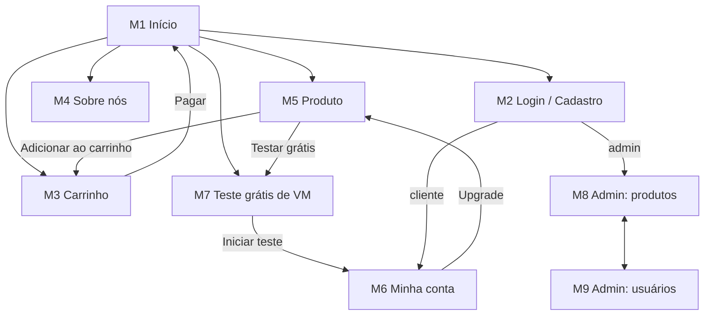

# Cache & Carry — Servidores na nuvem e VPN

**Grupo:** 3

| Nome | Nº USP |
|------|--------|
| _Pedro Henrique de Holanda_ | _14602612_ |
| _Luiz Henrique Nogueira dos Santos_ | _14755054_ |


Cache & Carry é uma loja online, feita para pessoas, que vende máquinas virtuais (VMs) e planos de VPN. Os clientes escolhem planos mensais com preços fixos em reais, pagam com cartão de crédito e acompanham seus serviços na própria conta. Todo cliente novo pode testar uma VM Standard de graça por 14 dias.

> **Etapa atual:** Milestone 1 — Mockups da loja.

---

## 1. Requisitos

**Requisitos do enunciado**

1. Dois tipos de usuário: clientes e administradores.
2. O sistema já vem com o administrador `admin`, senha `admin`.
3. Administrador tem: nome, id, telefone e e-mail.
4. Cliente tem: nome, id, endereço, telefone e e-mail.
5. Produto tem: nome, id, foto, descrição, preço, quantidade em estoque e quantidade vendida.
6. Venda: o cliente escolhe produtos e quantidades, coloca no carrinho e paga com cartão de crédito (qualquer número é aceito). Ao pagar, a quantidade comprada sai do estoque e soma na quantidade vendida. O carrinho só é esvaziado no pagamento ou pelo próprio cliente.
7. Administradores podem criar, ver, editar e excluir produtos (incluindo o estoque).
8. Administradores podem cadastrar e gerenciar administradores e clientes.
9. Funcionalidade específica da loja (ver requisito 11).
10. O sistema deve ser acessível, fácil de usar e rápido.

**Requisitos adicionados pelo grupo**

11. **Teste grátis de VM (nossa funcionalidade).** Cada conta pode iniciar um teste gratuito de 14 dias de uma VM Standard (2 vCPU, 4 GB RAM, 80 GB SSD), sem cartão de crédito. O cliente escolhe o sistema operacional, o data center, o nome do servidor e, opcionalmente, uma chave SSH. Ao fim dos 14 dias a VM é pausada e os arquivos ficam guardados por mais 7 dias; o cliente pode fazer upgrade para o plano pago a qualquer momento. Cada teste ativo consome uma unidade do estoque da VM Standard.
12. Os clientes são pessoas: nome, e-mail, telefone e endereço de cobrança.
13. Os produtos ficam em categorias: Máquinas virtuais, VPN e Add-ons (IP dedicado, backups, armazenamento extra).
14. Não é possível comprar mais do que existe em estoque (vagas disponíveis por data center). Produtos sem estoque aparecem como "Sold out".
15. Busca de produtos por nome.
16. Página "Sobre nós" com a história da loja, a equipe e o contato.

---

## 2. Descrição do Projeto

### Funcionalidades

- **Visitante:** ver planos, buscar, ver detalhes, ler a página Sobre nós, se cadastrar e fazer login.
- **Cliente:** tudo do visitante, mais carrinho, teste grátis de VM, pagamento e edição da própria conta.
- **Administrador:** gerenciar produtos, administradores e clientes.

### Telas (mockups)

Todas as telas são arquivos HTML5 que usam a mesma folha de estilos, [`static/style.css`](static/style.css). As imagens na pasta [`docs/mockups`](docs/mockups) são capturas das telas M5 a M9.

| ID | Tela | Arquivo | Imagem |
|----|------|---------|--------|
| M1 | Página inicial e planos | [index.html](html/index.html) | |
| M2 | Login e cadastro | [login.html](html/login.html) | |
| M3 | Carrinho e pagamento | [cart.html](html/cart.html) | |
| M4 | Sobre nós | [about.html](html/about.html) | |
| M5 | Detalhes do produto | [product.html](html/product.html) | [M5-product.png](docs/mockups/M5-product.png) |
| M6 | Minha conta | [account.html](html/account.html) | [M6-account.png](docs/mockups/M6-account.png) |
| M7 | Teste grátis de VM | [trial.html](html/trial.html) | [M7-trial.png](docs/mockups/M7-trial.png) |
| M8 | Admin: produtos | [admin-products.html](html/admin-products.html) | [M8-admin-products.png](docs/mockups/M8-admin-products.png) |
| M9 | Admin: usuários | [admin-users.html](html/admin-users.html) | [M9-admin-users.png](docs/mockups/M9-admin-users.png) |

### Diagrama de navegação

O diagrama abaixo representa a navegação planejada da aplicação no estilo **Single-Page Application**. Neste primeiro milestone, as telas implementadas em HTML foram mantidas em arquivos separados para representar os diferentes estados da interface e facilitar a revisão.



O cabeçalho (logo, busca, Sobre nós, Login e Carrinho) e a barra de categorias com o link para o teste grátis aparecem em todas as telas do cliente.

### Informações salvas no servidor

- **Administradores:** id, nome, telefone, e-mail, senha.
- **Clientes:** id, nome, endereço de cobrança, telefone, e-mail, senha.
- **Produtos:** id, nome, categoria, foto, descrição, especificações (vCPU, RAM, disco, dispositivos), preço mensal, estoque, quantidade vendida.
- **Testes grátis:** id, id do cliente, sistema operacional, data center, nome do servidor, chave SSH, data de início, data de fim, status.
- **Carrinhos:** id do cliente, produtos e quantidades.
- **Pedidos:** id, id do cliente, data, produtos, total, últimos 4 dígitos do cartão.

---

## 3. Comentários sobre o Código

As fotos dos produtos são emojis provisórios. Os estilos ficam todos em `static/style.css` (cores definidas como variáveis em `:root`); as páginas não usam mais estilos inline, exceto pequenos ajustes de espaçamento. A imagem `static/cooling.png` não é mais usada.

## 4. Plano de Testes

Ainda não feito. Pretendemos testar manualmente cada fluxo (compra, cadastro, gerenciamento de produtos) em computador e celular e, na versão final, testar o servidor com o Postman.

## 5. Resultados dos Testes

Ainda não há testes.

## 6. Procedimentos de Build

1. Instale o [Git](https://git-scm.com/) e um navegador.
2. Clone o repositório:
   ```bash
   git clone <url-do-repositório>
   ```
3. Abra o arquivo `html/index.html` no navegador.

## 7. Problemas

Sem problemas.

## 8. Comentários

Sem comentários.
