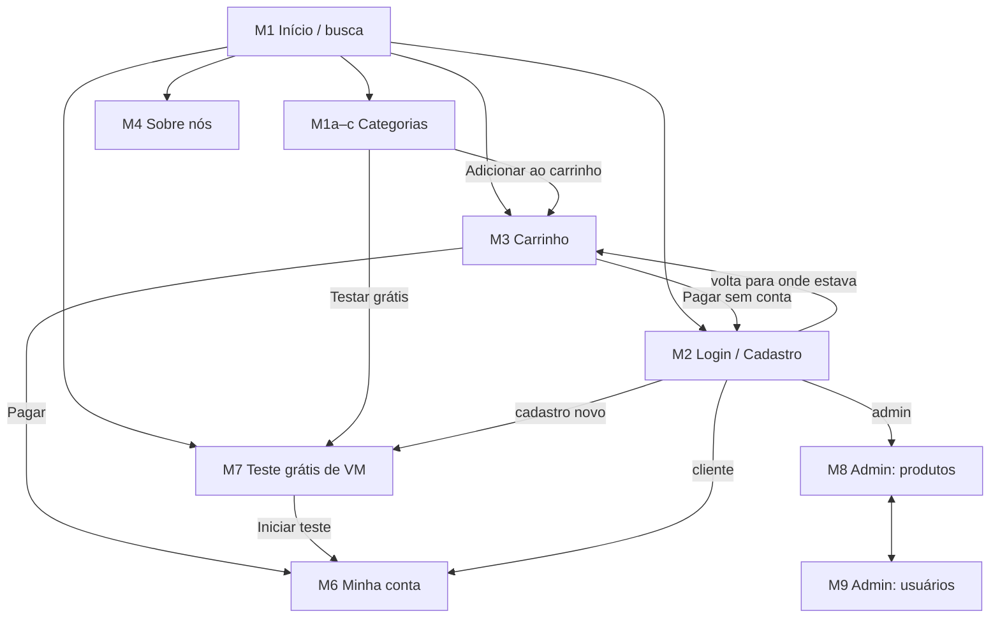

# Cache & Carry — Servidores na nuvem e VPN

**Grupo:** 3

| Nome | Nº USP |
|------|--------|
| _Pedro Henrique de Holanda_ | _14602612_ |
| _Luiz Henrique Nogueira dos Santos_ | _14755054_ |


Cache & Carry é uma loja online, feita para pessoas, que vende máquinas virtuais (VMs) e planos de VPN. Os clientes escolhem planos mensais com preços fixos em reais, pagam com cartão de crédito e acompanham seus serviços na própria conta. Todo cliente novo pode testar uma VM Standard de graça por 14 dias.

> **Etapa atual:** Milestone 2 — Funcionalidade do cliente (HTML5, CSS3 e JavaScript ES6, com o servidor simulado no navegador).

---

## 1. Requisitos

**Requisitos do enunciado**

1. Dois tipos de usuário: clientes e administradores.
2. O sistema já vem com o administrador `admin`, senha `admin`.
3. Administrador tem: nome, id, telefone e e-mail.
4. Cliente tem: nome, id, endereço, telefone e e-mail.
5. Produto tem: nome, id, foto, descrição, preço, quantidade em estoque e quantidade vendida.
6. Venda: o cliente escolhe produtos e quantidades, coloca no carrinho e paga com cartão de crédito (qualquer número é aceito). Ao pagar, a quantidade comprada sai do estoque e soma na quantidade vendida. O carrinho só é esvaziado no pagamento ou pelo próprio cliente.
7. Administradores podem criar, ver, editar e excluir produtos (incluindo o estoque).
8. Administradores podem cadastrar e gerenciar administradores e clientes.
9. Funcionalidade específica da loja (ver requisito 11).
10. O sistema deve ser acessível, fácil de usar e rápido.

**Requisitos adicionados pelo grupo**

11. **Teste grátis de VM (nossa funcionalidade).** Cada conta pode iniciar um teste gratuito de 14 dias de uma VM Standard (2 vCPU, 4 GB RAM, 80 GB SSD), sem cartão de crédito. O cliente escolhe o sistema operacional, o data center, o nome do servidor e, opcionalmente, uma chave SSH. Ao fim dos 14 dias a VM é pausada e os arquivos ficam guardados por mais 7 dias; o cliente pode fazer upgrade para o plano pago a qualquer momento. Cada teste ativo consome uma unidade do estoque da VM Standard.
12. Os clientes são pessoas: nome, e-mail, telefone e endereço de cobrança.
13. Os produtos ficam em categorias: Máquinas virtuais, VPN e Add-ons (IP dedicado, backups, armazenamento extra).
14. Não é possível comprar mais do que existe em estoque (vagas disponíveis por data center). Produtos sem estoque aparecem como "Sold out".
15. Busca de produtos por nome.
16. Página "Sobre nós" com a história da loja, a equipe e o contato.
17. **WebMCP.** A loja expõe ferramentas (tools) para agentes de IA rodando no navegador, para que um assistente possa buscar planos, ver detalhes e montar o carrinho. O pagamento é sempre confirmado pela pessoa: não existe ferramenta de pagar.
18. Opções de compra: VMs levam o data center e o sistema operacional escolhidos; planos de VPN levam o país de saída padrão.
19. Um visitante pode montar o carrinho sem conta; ao entrar ou se cadastrar, os itens passam para o carrinho do cliente.

---

## 2. Descrição do Projeto

### Funcionalidades implementadas

- **Visitante:** ver os planos (início e páginas de categoria), ordenar, buscar por nome, adicionar ao carrinho, ler a página Sobre nós, se cadastrar e entrar.
- **Cliente:** tudo do visitante, mais pagamento com cartão, histórico de pedidos, edição dos próprios dados e da senha, e o teste grátis de VM (um por conta).
- **Administrador:** criar, ver, editar e excluir produtos (incluindo estoque, quantidade vendida e foto); cadastrar, editar e excluir clientes e administradores.
- **Agentes de IA (WebMCP):** buscar e consultar produtos, adicionar e alterar itens do carrinho e abrir a página de pagamento.

Regras de venda, como pede o enunciado: não dá para colocar no carrinho mais do que existe em estoque; ao pagar, a quantidade comprada sai do estoque e soma na quantidade vendida; o carrinho só é esvaziado no pagamento ou pelo próprio cliente. O pagamento é verificado de novo no momento de pagar: se o estoque acabou depois de o item entrar no carrinho, nada é cobrado.

### Telas

Todas as telas são arquivos HTML5 com a mesma folha de estilos ([`static/style.css`](static/style.css)). Os cartões de produto, o carrinho, as tabelas do admin e a conta são desenhados por JavaScript a partir dos dados.

| ID | Tela | Arquivo |
|----|------|---------|
| M1 | Página inicial, planos e resultados da busca | [index.html](html/index.html) |
| M1a | Categoria: máquinas virtuais | [vms.html](html/vms.html) |
| M1b | Categoria: VPN | [vpn.html](html/vpn.html) |
| M1c | Categoria: add-ons | [addons.html](html/addons.html) |
| M2 | Login e cadastro | [login.html](html/login.html) |
| M3 | Carrinho e pagamento | [cart.html](html/cart.html) |
| M4 | Sobre nós | [about.html](html/about.html) |
| M6 | Minha conta | [account.html](html/account.html) |
| M7 | Teste grátis de VM | [trial.html](html/trial.html) |
| M8 | Admin: produtos | [admin-products.html](html/admin-products.html) |
| M9 | Admin: usuários | [admin-users.html](html/admin-users.html) |

A tela M5 (detalhes do produto) do Milestone 1 foi incorporada às páginas de categoria: cada cartão mostra descrição, especificações, estoque, quantidade e o botão de adicionar. Os links da página inicial levam direto ao cartão do produto (por exemplo `vms.html#standard-vm`).

### Diagrama de navegação



Neste milestone as telas continuam em arquivos HTML separados, que compartilham o mesmo código JavaScript. Na versão final, com o servidor em Node.js, a aplicação passará para o estilo Single-Page Application; a camada de dados (`db.js`) e as regras (`auth.js`, `cart.js`) foram escritas para serem reaproveitadas sem mudança.

### Informações salvas no servidor

Neste milestone o "servidor" é simulado no navegador (`localStorage`), como o enunciado permite. Cada coleção abaixo corresponde a uma futura rota REST.

- **users** (administradores e clientes): id, papel (`admin` ou `customer`), nome, e-mail, telefone, usuário (admins), endereço (clientes), hash e salt da senha.
- **products:** id, nome, categoria, ícone ou foto, descrição, especificações, preço mensal, unidade de cobrança, estoque, quantidade vendida, se oferece teste grátis.
- **carts:** id do dono (cliente ou `guest`), itens com produto, quantidade e opções escolhidas.
- **orders:** id, id do cliente, data, itens (nome, preço, quantidade e opções no momento da compra), total, últimos 4 dígitos do cartão.
- **trials:** id, id do cliente, sistema operacional, data center, nome do servidor, chave SSH, início e fim.

### WebMCP

[WebMCP](https://developer.chrome.com/docs/ai/webmcp/imperative-api) é um padrão experimental (origin trial do Chrome) que deixa uma página registrar ferramentas para agentes de IA com `document.modelContext.registerTool()`. O arquivo [`static/js/webmcp.js`](static/js/webmcp.js) registra:

| Ferramenta | O que faz | Anotação |
|---|---|---|
| `search_products` | Busca por palavras, categoria, preço máximo e estoque | somente leitura |
| `get_product` | Detalhes de um produto pelo id | somente leitura |
| `add_to_cart` | Adiciona ao carrinho, com data center e SO para VMs e país de saída para VPN (opções omitidas recebem o padrão da página) | |
| `view_cart` | Itens, quantidades e total | somente leitura |
| `update_cart_item` | Muda a quantidade (0 remove), limitada ao estoque | |
| `go_to_checkout` | Abre a página de pagamento (avisa se a pessoa precisa entrar; recusa para admins) | consequencial |
| `set_stock` | Muda o estoque (registrada só quando um admin está logado) | consequencial |

As ferramentas usam as mesmas funções dos botões, então seguem as mesmas regras (limite de estoque, login, papel do usuário). Por segurança, não existe ferramenta de pagamento: o agente leva o cliente até o formulário, e a pessoa digita o cartão e confirma. Em navegadores sem WebMCP o arquivo não faz nada.

O navegador **não** confere os argumentos contra o `inputSchema` (testado no Chromium 148), então cada ferramenta confere os próprios argumentos (tipo, obrigatórios, valores permitidos, mínimo) e responde com uma frase como `Invalid input: "quantity" must be at least 1.` em vez de lançar erro. As listas de opções (data center, SO, país de saída) ficam em `DB.CATEGORIES` e são as mesmas da página e dos schemas. Mudanças no carrinho passam por uma fila, porque agentes costumam chamar ferramentas em paralelo e duas mudanças ao mesmo tempo apagariam uma à outra.

---

## 3. Comentários sobre o Código

```
index.html              redireciona para html/index.html
html/                   uma página por tela
static/style.css        todos os estilos (cores como variáveis em :root)
static/js/
  db.js                 "servidor" simulado: coleções no localStorage, atraso de 100 ms, CRUD genérico e transações
  auth.js               cadastro, login, logout, proteção de páginas, CRUD de usuários; senhas com SHA-256 + salt
  cart.js               carrinho, limite de estoque e pagamento
  ui.js                 funções compartilhadas: escapar HTML, avisos (toasts), cartão de produto
  catalog.js            desenha os produtos, busca e ordenação
  cart-page.js, account.js, trial.js, login.js, admin-products.js, admin-users.js   uma por página
  webmcp.js             ferramentas para agentes de IA
tests/                  testes automáticos (Playwright)
```

- Todas as funções que acessam dados são `async` e passam por `db.js`. Para a versão final basta trocar o corpo dessas funções por `fetch()` para a API em Node.js; as páginas não mudam.
- Os dados são escapados antes de entrar no HTML (`UI.esc`), porque nomes de produtos e de usuários são digitados por pessoas.
- O pagamento usa `DB.transaction`: estoque, vendidos, pedido e carrinho mudam juntos, ou nada muda.
- Do cartão, só os últimos 4 dígitos são guardados.
- **Limitação conhecida:** como tudo roda no navegador, qualquer pessoa pode editar o `localStorage` e se tornar administradora. As verificações de papel precisam ir para o servidor na versão final.
- Para voltar os dados ao estado inicial, rode `DB.reset()` no console do navegador ou limpe os dados do site.
- As fotos dos produtos são emojis; o admin pode enviar uma foto, que é reduzida para 400 px para caber no `localStorage`.

## 4. Plano de Testes

Os testes são automáticos, escritos com [Playwright](https://playwright.dev/), e ficam em [`tests/`](tests). Cada teste abre um navegador limpo (sem dados salvos), executa o fluxo como um usuário faria e confere o resultado.

| Grupo | O que é testado |
|---|---|
| T1 Catálogo | Todos os produtos aparecem; produto esgotado não pode ser adicionado; ordenação por preço |
| T2 Busca | Busca por nome; mensagem quando nada é encontrado |
| T3 Contas | Senha errada; login do `admin`/`admin` e logout; cadastro; e-mail duplicado; páginas protegidas redirecionam para o login e voltam; cliente não abre o admin e admin não abre a conta de cliente, sem ficar indo e voltando entre as páginas; cliente edita os dados e a senha |
| T4 Carrinho | Adicionar atualiza o contador; não passa do estoque; opções da VM ficam no item; mudar quantidade, remover e esvaziar; carrinho do visitante passa para a conta ao entrar |
| T5 Pagamento | Visitante precisa entrar; pagar tira do estoque, soma em vendidos, salva o pedido e esvazia o carrinho; cartão vencido é recusado; estoque que acabou depois impede o pagamento |
| T6 Admin: produtos | Criar, editar, mudar estoque (o produto fica esgotado na loja) e excluir; dados inválidos são recusados |
| T7 Admin: usuários | Cadastrar cliente e administrador (e entrar com eles); editar e excluir; o `admin` padrão não pode ser excluído |
| T8 Teste grátis | Visitante é avisado; cliente inicia o teste, que aparece na conta e usa uma unidade do estoque; segundo teste é bloqueado |
| T9 WebMCP | As ferramentas são registradas; um agente busca e adiciona ao carrinho com as mesmas regras; `set_stock` só existe para admins |
| W1–W6 WebMCP real | Rodam no WebMCP **de verdade** do Chromium (não um falso): as ferramentas aparecem em todas as páginas; schemas válidos e iguais às opções da página; não existe ferramenta de pagar; `set_stock` só para admin; busca com filtros; argumentos inválidos são recusados com uma frase; limites de estoque; opções padrão; chamadas em paralelo não perdem itens nem passam do estoque; `view_cart`/`update_cart_item` com chaves inválidas; `go_to_checkout` para cliente, visitante e admin; `set_stock` para de funcionar se o admin sair em outra aba |
| T10 Regressões | Renomear o admin padrão não quebra o login; produto excluído não bloqueia o pagamento; armazenamento cheio gera erro em vez de perder dados; juntar o carrinho do visitante respeita o estoque; apagar a quantidade não remove o item; teste grátis encerrado ou de usuário excluído devolve a VM ao estoque |
| Celular | Cada página cabe numa tela de celular (Pixel 7) sem rolagem lateral e sem erros de JavaScript; comprar funciona no celular |

O grupo T9 instala um `document.modelContext` falso e roda em qualquer navegador. Os grupos W1–W6 ([`tests/webmcp.spec.js`](tests/webmcp.spec.js)) usam o WebMCP real: o projeto `webmcp` do Playwright abre um Chrome/Chromium 146 ou mais novo instalado no sistema com a flag `--enable-features=WebMCP,WebMCPTesting` e chama as ferramentas por `navigator.modelContextTesting` (ou `document.modelContext.executeTool` nas versões novas), como um agente faria. O Chromium que vem com o Playwright é antigo demais para isso.

Para rodar os testes, veja o passo 5 de [Procedimentos de Build](#6-procedimentos-de-build).

## 5. Resultados dos Testes

Última execução: 90 testes, 90 aprovados (41 no computador, 9 no celular e 40 no WebMCP real com Chromium 148). O grupo WebMCP também passou 5 vezes seguidas (200 execuções) sem falhas intermitentes.

```
  ✓ [desktop] T1 Catalog › home page lists every product from the data
  ✓ [desktop] T1 Catalog › category page shows details, and sold-out products can't be added
  ✓ [desktop] T1 Catalog › sorting by price puts the cheapest first
  ✓ [desktop] T2 Search › finds products by name
  ✓ [desktop] T2 Search › explains when nothing matches
  ✓ [desktop] T3 Sign-in and accounts › wrong password shows an error
  ✓ [desktop] T3 Sign-in and accounts › admin/admin opens the admin area, and sign-out works
  ✓ [desktop] T3 Sign-in and accounts › a new customer can register and is signed in
  ✓ [desktop] T3 Sign-in and accounts › the same email can't register twice
  ✓ [desktop] T3 Sign-in and accounts › protected pages send visitors to sign in and back
  ✓ [desktop] T3 Sign-in and accounts › customers can't open admin pages
  ✓ [desktop] T3 Sign-in and accounts › customers can edit their details and password
  ✓ [desktop] T4 Cart › adding updates the badge and the cart page
  ✓ [desktop] T4 Cart › can't add more than the stock
  ✓ [desktop] T4 Cart › VM options are kept with the cart line
  ✓ [desktop] T4 Cart › quantity can be changed and lines removed
  ✓ [desktop] T4 Cart › a visitor's cart is kept after signing in
  ✓ [desktop] T5 Checkout › visitors are asked to sign in before paying
  ✓ [desktop] T5 Checkout › paying moves stock to sold, saves the order and empties the cart
  ✓ [desktop] T5 Checkout › an expired card is rejected and nothing changes
  ✓ [desktop] T5 Checkout › checkout fails if stock ran out after adding
  ✓ [desktop] T6 Admin: products › create, edit, restock and delete a product
  ✓ [desktop] T6 Admin: products › invalid product data is refused
  ✓ [desktop] T7 Admin: users › register a customer who can then sign in
  ✓ [desktop] T7 Admin: users › register another administrator
  ✓ [desktop] T7 Admin: users › edit and delete a customer; the default admin is protected
  ✓ [desktop] T8 Free trial (our feature) › visitors are told to sign in
  ✓ [desktop] T8 Free trial (our feature) › a customer starts one trial and sees it on their account
  ✓ [desktop] T9 WebMCP tools › registers the store tools
  ✓ [desktop] T9 WebMCP tools › an agent can search and add to the cart, with the same stock rules
  ✓ [desktop] T9 WebMCP tools › the admin-only set_stock tool appears only for admins
  ✓ [desktop] T10 Regressions › 7 tests (renamed admin, deleted product, full storage, guest cart merge, empty quantity, trial stock ×2)
  ✓ [phone] index.html, vms.html, vpn.html, addons.html, cart.html, login.html, about.html, trial.html › fit the screen and have no script errors (8 tests)
  ✓ [phone] buying works on a phone

  ✓ [webmcp] W1–W6 › 40 tests against Chromium 148's real WebMCP

  90 passed
```

Problema corrigido: quem estava logado com o papel errado para uma página (por exemplo, o admin abrindo `account.html`, ou entrando como admin por um link `login.html?next=account.html`) ficava preso indo e voltando entre a página e o login. Agora o login só segue o `next` se o papel puder abrir a página; se não puder, explica e deixa entrar com outra conta.

Problemas encontrados pelos testes no WebMCP real e corrigidos: o navegador não valida os argumentos, então `search_products` com `query` numérico quebrava, `set_stock` com estoque negativo virava 0 em silêncio e data centers inexistentes eram aceitos; chamadas em paralelo de `add_to_cart` perdiam itens e podiam passar do estoque; itens adicionados pelo agente sem opções ficavam numa linha diferente da do botão, e não dava para escolher o país da VPN; `update_cart_item` com chave inexistente dizia que o item tinha esgotado; `go_to_checkout` levava admins ao pagamento e não avisava que um visitante precisa entrar.

Problema encontrado pelos testes e corrigido: formulários enviados antes de o JavaScript terminar de carregar faziam a página recarregar.

Problemas encontrados em revisão de código e corrigidos (grupo T10): mudar o nome de usuário do admin padrão travava o login em todas as páginas; um produto excluído deixava uma linha invisível no carrinho que impedia o pagamento; com o armazenamento cheio as alterações eram perdidas sem aviso; o carrinho do visitante podia passar do estoque ao entrar na conta; e a VM de um teste grátis nunca voltava ao estoque.

## 6. Procedimentos de Build

**Para usar a loja**

1. Instale o [Git](https://git-scm.com/), o [Node.js](https://nodejs.org/) (versão 18 ou mais nova) e um navegador atual (Chrome, Edge, Firefox ou Safari).
2. Clone o repositório e entre na pasta:
   ```bash
   git clone https://github.com/AoiUltramar/Milestone-1-SCC0219-.git
   cd Milestone-1-SCC0219-
   git checkout vm-vpn-path
   ```
3. Instale as dependências e inicie o servidor HTTP local:
   ```bash
   npm install
   npm start
   ```
   O navegador abre em `http://localhost:8080`, que leva a `html/index.html`.
   *Sem Node.js:* qualquer servidor HTTP serve, por exemplo `python3 -m http.server 8080` na pasta do projeto, e depois abra `http://localhost:8080`.
4. Entre como administrador com **admin** / **admin**, ou crie uma conta de cliente na tela de login.

**Para rodar os testes**

5. Com o passo 3 feito, instale o navegador do Playwright uma vez e rode os testes:
   ```bash
   npx playwright install chromium
   npm test
   ```
   O Playwright inicia o servidor sozinho. Para ver o relatório com detalhes de cada teste: `npm run test:report`.

   Os testes do WebMCP real rodam quando existe um Chrome/Chromium 146+ em `/usr/bin/chromium` ou `/usr/bin/google-chrome`; em outro lugar, informe o caminho: `WEBMCP_CHROME="/caminho/do/chrome" npm test`. Só eles: `npx playwright test --project=webmcp`.

**Para experimentar o WebMCP**

6. Use um Chrome com suporte a WebMCP (origin trial ou a flag de WebMCP ativada em `chrome://flags`) e uma extensão ou agente compatível. Abra o console: a mensagem `WebMCP: registered 6 tools.` confirma o registro (7 com um admin logado). Para testar à mão, abra o Chromium com `--enable-features=WebMCP,WebMCPTesting` e rode no console `await navigator.modelContextTesting.executeTool("search_products", '{"query":"vpn"}')`.

## 7. Problemas

- O WebMCP ainda é experimental e só funciona em versões recentes do Chrome com o recurso ativado; a loja funciona normalmente sem ele.
- Os dados ficam no navegador de cada pessoa: dois navegadores não compartilham estoque nem contas. Isso será resolvido com o servidor na versão final.

## 8. Comentários

Sem comentários.
